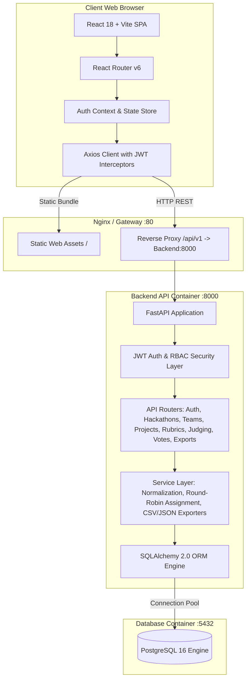
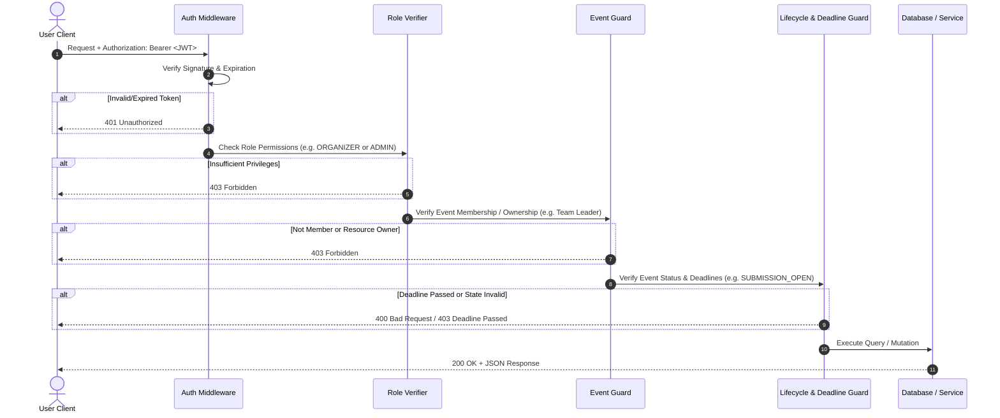
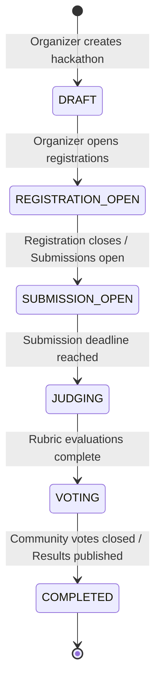

# Architecture Documentation — Open-Source Hackathon Platform

## 1. Executive Overview

The **Open-Source Hackathon Management & Judging Platform** is a production-grade, self-hostable, 100% offline-capable web application designed to run hackathons from initial organization through participant registration, team formation, project submission, weighted rubric judging with statistical normalization, public showcase, community voting, and final data exports.

The platform is strictly architected with **zero external cloud dependencies** (no Firebase, Supabase, Auth0, or hosted database dependencies). It packages a Python FastAPI REST API, a React + Vite + Tailwind CSS Single Page Application, and a PostgreSQL database into an orchestratable Docker Compose architecture.

---

## 2. High-Level System Architecture



---

## 3. Technology Stack Rationale

| Layer | Technology | Decision Justification |
| :--- | :--- | :--- |
| **Frontend** | React 18, TypeScript, Vite, Tailwind CSS | High performance, rapid component composition, complete type safety, responsive modern UI, and self-contained static bundling. |
| **Backend** | Python 3.11, FastAPI, Pydantic v2 | High concurrency with asynchronous endpoints, automatic OpenAPI/Swagger documentation, strict request/response data contracts, and Python's numerical prowess for scoring calculations. |
| **Database** | PostgreSQL 16 & SQLAlchemy 2.0 | ACID-compliant relational integrity, complex foreign keys for team & rubric hierarchies, JSON column flexibility, plus seamless local SQLite fallback for isolated unit tests. |
| **Authentication** | Local JWT (HS256) & Bcrypt Password Hashing | Cryptographically secure, stateless authentication with zero external auth vendors or telemetric phoning home. |
| **Containerization** | Docker & Docker Compose | Single-command deployment (`docker compose up`) orchestrating healthchecked PostgreSQL, backend migrations, seed data, and frontend assets. |

---

## 4. Role-Based Access Control (RBAC) Specification

The backend enforces four strict hierarchical roles:
1. `ADMIN`: System-wide administrator. Can manage all hackathons, override states, assign roles, inspect audit logs, and trigger system-wide exports.
2. `ORGANIZER`: Hackathon creator and director. Manages event settings, registration & submission deadlines, rubrics, tracks, judge invitations, judge assignments, and finalized results publication.
3. `JUDGE`: Evaluator invited to grade projects. Granted read access to assigned submissions and write access to scorecards matching defined rubric criteria during the `JUDGING` lifecycle phase.
4. `PARTICIPANT`: Hackathon entrant. Can register for events, form or join teams via invite codes, submit projects before deadlines, upvote in community voting, and view public showcases.

### Multi-Tiered Request Verification Pipeline

Every backend endpoint requiring protection executes a multi-stage validation dependency:



---

## 5. Hackathon Lifecycle State Machine

A hackathon moves through strict chronological phases:



1. **`DRAFT`**: Only organizers and admins can see or modify the hackathon. Tracks, rubrics, and dates are configured.
2. **`REGISTRATION_OPEN`**: Participants can register for the hackathon and create/join teams using unique invite codes.
3. **`SUBMISSION_OPEN`**: Registered teams can draft and finalize project submissions (tagline, markdown description, video, GitHub, demo URLs).
4. **`JUDGING`**: Project submissions are locked from editing. Judges receive assigned projects and score them against the weighted rubric.
5. **`VOTING`**: Public project gallery allows participants and community members to cast upvotes (if community voting is enabled).
6. **`COMPLETED`**: Final leaderboard, normalized rankings, track winners, and judge feedback are published. Exports are finalized.

---

## 6. Directory Layout

```
hackathon-platform/
├── backend/
│   ├── app/
│   │   ├── models/          # SQLAlchemy Database Models
│   │   ├── schemas/         # Pydantic Request & Response Models
│   │   ├── routers/         # REST API Endpoints (Auth, Hackathons, Judging, etc.)
│   │   ├── services/        # Business Logic (Normalization, Round-Robin, Exports)
│   │   ├── config.py        # Environment Configuration
│   │   ├── database.py      # Engine and Session Manager
│   │   ├── seed.py          # Demo Dataset Initializer
│   │   └── main.py          # FastAPI Root Application
│   ├── tests/               # Pytest Automated Test Suite
│   ├── Dockerfile           # Backend Container Build
│   └── requirements.txt     # Python Dependencies
├── frontend/
│   ├── src/
│   │   ├── components/      # UI Library (Navbar, Cards, Modals, Badges)
│   │   ├── pages/           # Route Views (Dashboard, Gallery, Judging, Admin)
│   │   ├── services/        # Axios API Client & Endpoints
│   │   ├── types/           # TypeScript Domain Definitions
│   │   └── App.tsx          # Root Layout & Routing
│   ├── nginx.conf           # Web Server & Reverse Proxy
│   ├── Dockerfile           # Multi-Stage Frontend Build
│   └── package.json
├── docker-compose.yml       # Production Compose Specification
├── README.md                # Platform Guide & Quickstart
├── ARCHITECTURE.md          # Architectural Specification
├── DATA-MODEL.md            # Schema & Entity Relations
├── JUDGING.md               # Statistical Normalization Algorithms
├── acceptance-report.txt    # Acceptance Verification Log
└── LICENSE                  # MIT License
```
