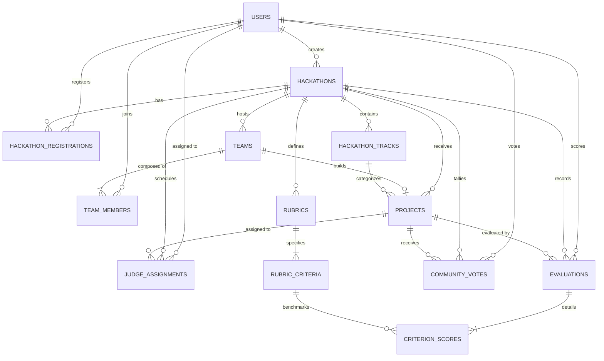

# Data Model Specification — Open-Source Hackathon Platform

## 1. Entity-Relationship Overview

---

## 2. Table Schemas and Attributes

### 2.1 `users`
Stores core user credentials and global role classifications.

| Column | Type | Constraints | Description |
| :--- | :--- | :--- | :--- |
| `id` | INTEGER | PRIMARY KEY, AUTO_INCREMENT | Unique user identifier |
| `email` | VARCHAR(255) | UNIQUE, NOT NULL, INDEX | Primary email address |
| `username` | VARCHAR(50) | UNIQUE, NOT NULL, INDEX | Unique handle |
| `hashed_password` | VARCHAR(255) | NOT NULL | Bcrypt hash |
| `full_name` | VARCHAR(100) | NOT NULL | Display name |
| `role` | VARCHAR(20) | NOT NULL, DEFAULT 'PARTICIPANT' | Role: `PARTICIPANT`, `JUDGE`, `ORGANIZER`, `ADMIN` |
| `bio` | TEXT | NULLABLE | Profile bio |
| `avatar_url` | VARCHAR(500) | NULLABLE | Avatar image URI |
| `is_active` | BOOLEAN | NOT NULL, DEFAULT TRUE | Account state |
| `created_at` | TIMESTAMP WITH TIME ZONE | NOT NULL, DEFAULT NOW() | Registration timestamp |

---

### 2.2 `hackathons`
Represents an individual competition event.

| Column | Type | Constraints | Description |
| :--- | :--- | :--- | :--- |
| `id` | INTEGER | PRIMARY KEY, AUTO_INCREMENT | Unique hackathon identifier |
| `title` | VARCHAR(200) | NOT NULL | Hackathon title |
| `slug` | VARCHAR(200) | UNIQUE, NOT NULL, INDEX | URL-friendly slug |
| `tagline` | VARCHAR(300) | NOT NULL | Brief summary |
| `description` | TEXT | NOT NULL | Detailed markdown content |
| `banner_url` | VARCHAR(500) | NULLABLE | Header banner image URI |
| `status` | VARCHAR(30) | NOT NULL, DEFAULT 'DRAFT' | `DRAFT`, `REGISTRATION_OPEN`, `SUBMISSION_OPEN`, `JUDGING`, `VOTING`, `COMPLETED` |
| `registration_start` | TIMESTAMP WITH TIME ZONE | NOT NULL | Start of registrations |
| `registration_deadline`| TIMESTAMP WITH TIME ZONE | NOT NULL | End of registrations |
| `submission_deadline` | TIMESTAMP WITH TIME ZONE | NOT NULL | Project submissions close |
| `judging_deadline` | TIMESTAMP WITH TIME ZONE | NOT NULL | Judge grading closes |
| `created_by_id` | INTEGER | NOT NULL, FK(`users.id`) | Organizer who created the event |
| `is_community_voting_enabled` | BOOLEAN | NOT NULL, DEFAULT TRUE | Community upvoting toggle |
| `min_team_size` | INTEGER | NOT NULL, DEFAULT 1 | Minimum participants per team |
| `max_team_size` | INTEGER | NOT NULL, DEFAULT 4 | Maximum participants per team |
| `created_at` | TIMESTAMP WITH TIME ZONE | NOT NULL, DEFAULT NOW() | Creation timestamp |
| `updated_at` | TIMESTAMP WITH TIME ZONE | NOT NULL, DEFAULT NOW() | Last updated timestamp |

---

### 2.3 `hackathon_tracks`
Categories / thematic tracks within an event.

| Column | Type | Constraints | Description |
| :--- | :--- | :--- | :--- |
| `id` | INTEGER | PRIMARY KEY, AUTO_INCREMENT | Unique track identifier |
| `hackathon_id` | INTEGER | NOT NULL, FK(`hackathons.id`), ON DELETE CASCADE | Associated hackathon |
| `name` | VARCHAR(100) | NOT NULL | Track name (e.g. AI & ML) |
| `description` | TEXT | NOT NULL | Challenge prompt & rules |

---

### 2.4 `hackathon_registrations`
Participant registration records for specific hackathons.

| Column | Type | Constraints | Description |
| :--- | :--- | :--- | :--- |
| `id` | INTEGER | PRIMARY KEY, AUTO_INCREMENT | Unique registration ID |
| `hackathon_id` | INTEGER | NOT NULL, FK(`hackathons.id`), ON DELETE CASCADE | Target hackathon |
| `user_id` | INTEGER | NOT NULL, FK(`users.id`), ON DELETE CASCADE | Participant user |
| `status` | VARCHAR(20) | NOT NULL, DEFAULT 'REGISTERED' | `REGISTERED`, `CHECKED_IN`, `WITHDRAWN` |
| `registered_at` | TIMESTAMP WITH TIME ZONE | NOT NULL, DEFAULT NOW() | Timestamp |

*Unique Constraint*: `(hackathon_id, user_id)`

---

### 2.5 `teams` & `team_members`
Teams formed by participants within a hackathon.

**`teams`**:
| Column | Type | Constraints | Description |
| :--- | :--- | :--- | :--- |
| `id` | INTEGER | PRIMARY KEY, AUTO_INCREMENT | Team ID |
| `hackathon_id` | INTEGER | NOT NULL, FK(`hackathons.id`), ON DELETE CASCADE | Target hackathon |
| `name` | VARCHAR(100) | NOT NULL | Team name |
| `invite_code` | VARCHAR(32) | UNIQUE, NOT NULL, INDEX | Secret join token |
| `leader_id` | INTEGER | NOT NULL, FK(`users.id`) | Team creator / leader |
| `created_at` | TIMESTAMP WITH TIME ZONE | NOT NULL, DEFAULT NOW() | Creation timestamp |

**`team_members`**:
| Column | Type | Constraints | Description |
| :--- | :--- | :--- | :--- |
| `id` | INTEGER | PRIMARY KEY, AUTO_INCREMENT | Membership ID |
| `team_id` | INTEGER | NOT NULL, FK(`teams.id`), ON DELETE CASCADE | Team |
| `user_id` | INTEGER | NOT NULL, FK(`users.id`), ON DELETE CASCADE | User |
| `role` | VARCHAR(20) | NOT NULL, DEFAULT 'MEMBER' | `LEADER`, `MEMBER` |
| `joined_at` | TIMESTAMP WITH TIME ZONE | NOT NULL, DEFAULT NOW() | Join timestamp |

*Unique Constraint on `team_members`*: `(team_id, user_id)`

---

### 2.6 `projects`
Project submissions built by teams.

| Column | Type | Constraints | Description |
| :--- | :--- | :--- | :--- |
| `id` | INTEGER | PRIMARY KEY, AUTO_INCREMENT | Unique project ID |
| `hackathon_id` | INTEGER | NOT NULL, FK(`hackathons.id`), ON DELETE CASCADE | Associated hackathon |
| `team_id` | INTEGER | NOT NULL, FK(`teams.id`), ON DELETE CASCADE | Submitting team |
| `track_id` | INTEGER | NULLABLE, FK(`hackathon_tracks.id`) | Category track |
| `title` | VARCHAR(200) | NOT NULL | Project title |
| `tagline` | VARCHAR(300) | NOT NULL | Short pitch |
| `description` | TEXT | NOT NULL | Full markdown details |
| `demo_url` | VARCHAR(500) | NULLABLE | Live preview URL |
| `repo_url` | VARCHAR(500) | NULLABLE | Source code repository URL |
| `video_url` | VARCHAR(500) | NULLABLE | Demo video URL |
| `tech_stack` | TEXT | NULLABLE | Comma-separated or JSON list |
| `cover_image_url` | VARCHAR(500) | NULLABLE | Thumbnail image URL |
| `status` | VARCHAR(20) | NOT NULL, DEFAULT 'DRAFT' | `DRAFT`, `SUBMITTED` |
| `submitted_at` | TIMESTAMP WITH TIME ZONE | NULLABLE | Finalization timestamp |
| `created_at` | TIMESTAMP WITH TIME ZONE | NOT NULL, DEFAULT NOW() | Created at |
| `updated_at` | TIMESTAMP WITH TIME ZONE | NOT NULL, DEFAULT NOW() | Updated at |

*Unique Constraint*: `(hackathon_id, team_id)` — One project per team per hackathon.

---

### 2.7 `rubrics` & `rubric_criteria`
Configurable scoring rubrics and weighted evaluation criteria.

**`rubrics`**:
| Column | Type | Constraints | Description |
| :--- | :--- | :--- | :--- |
| `id` | INTEGER | PRIMARY KEY, AUTO_INCREMENT | Rubric ID |
| `hackathon_id` | INTEGER | NOT NULL, FK(`hackathons.id`), ON DELETE CASCADE | Hackathon |
| `name` | VARCHAR(100) | NOT NULL | Rubric title (e.g. Standard Rubric) |
| `description` | TEXT | NULLABLE | Guidance notes for judges |

**`rubric_criteria`**:
| Column | Type | Constraints | Description |
| :--- | :--- | :--- | :--- |
| `id` | INTEGER | PRIMARY KEY, AUTO_INCREMENT | Criterion ID |
| `rubric_id` | INTEGER | NOT NULL, FK(`rubrics.id`), ON DELETE CASCADE | Rubric |
| `title` | VARCHAR(100) | NOT NULL | Criterion name |
| `description` | TEXT | NOT NULL | Evaluation instructions |
| `max_points` | FLOAT | NOT NULL, DEFAULT 10.0 | Maximum raw points |
| `weight` | FLOAT | NOT NULL, DEFAULT 0.25 | Relative weight (sum = 1.0 or 100%) |

---

### 2.8 `judge_assignments`
Assigns a judge to evaluate a specific project submission.

| Column | Type | Constraints | Description |
| :--- | :--- | :--- | :--- |
| `id` | INTEGER | PRIMARY KEY, AUTO_INCREMENT | Assignment ID |
| `hackathon_id` | INTEGER | NOT NULL, FK(`hackathons.id`), ON DELETE CASCADE | Hackathon |
| `judge_id` | INTEGER | NOT NULL, FK(`users.id`), ON DELETE CASCADE | Judge |
| `project_id` | INTEGER | NOT NULL, FK(`projects.id`), ON DELETE CASCADE | Project |
| `status` | VARCHAR(20) | NOT NULL, DEFAULT 'PENDING' | `PENDING`, `COMPLETED` |
| `assigned_at` | TIMESTAMP WITH TIME ZONE | NOT NULL, DEFAULT NOW() | Assigned timestamp |

*Unique Constraint*: `(judge_id, project_id)`

---

### 2.9 `evaluations` & `criterion_scores`
Individual judge evaluations and itemized rubric scores.

**`evaluations`**:
| Column | Type | Constraints | Description |
| :--- | :--- | :--- | :--- |
| `id` | INTEGER | PRIMARY KEY, AUTO_INCREMENT | Evaluation ID |
| `hackathon_id` | INTEGER | NOT NULL, FK(`hackathons.id`), ON DELETE CASCADE | Hackathon |
| `project_id` | INTEGER | NOT NULL, FK(`projects.id`), ON DELETE CASCADE | Project |
| `judge_id` | INTEGER | NOT NULL, FK(`users.id`), ON DELETE CASCADE | Judge |
| `private_notes` | TEXT | NULLABLE | Private internal notes |
| `public_feedback` | TEXT | NULLABLE | Constructive feedback |
| `total_raw_score` | FLOAT | NOT NULL, DEFAULT 0.0 | Weighted raw score sum |
| `submitted_at` | TIMESTAMP WITH TIME ZONE | NOT NULL, DEFAULT NOW() | Submitted timestamp |
| `updated_at` | TIMESTAMP WITH TIME ZONE | NOT NULL, DEFAULT NOW() | Last edited timestamp |

*Unique Constraint*: `(project_id, judge_id)`

**`criterion_scores`**:
| Column | Type | Constraints | Description |
| :--- | :--- | :--- | :--- |
| `id` | INTEGER | PRIMARY KEY, AUTO_INCREMENT | Score ID |
| `evaluation_id` | INTEGER | NOT NULL, FK(`evaluations.id`), ON DELETE CASCADE | Evaluation |
| `criterion_id` | INTEGER | NOT NULL, FK(`rubric_criteria.id`), ON DELETE CASCADE | Criterion |
| `score` | FLOAT | NOT NULL | Raw score given (0..max_points) |

*Unique Constraint*: `(evaluation_id, criterion_id)`

---

### 2.10 `community_votes`
Community upvotes cast for projects during the `VOTING` or public phase.

| Column | Type | Constraints | Description |
| :--- | :--- | :--- | :--- |
| `id` | INTEGER | PRIMARY KEY, AUTO_INCREMENT | Vote ID |
| `hackathon_id` | INTEGER | NOT NULL, FK(`hackathons.id`), ON DELETE CASCADE | Hackathon |
| `project_id` | INTEGER | NOT NULL, FK(`projects.id`), ON DELETE CASCADE | Project |
| `user_id` | INTEGER | NOT NULL, FK(`users.id`), ON DELETE CASCADE | Voter |
| `created_at` | TIMESTAMP WITH TIME ZONE | NOT NULL, DEFAULT NOW() | Vote timestamp |

*Unique Constraint*: `(project_id, user_id)` — One vote per project per user.
